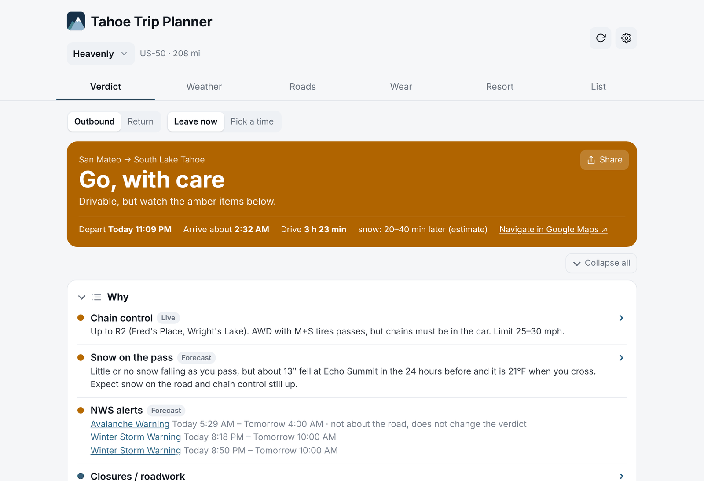
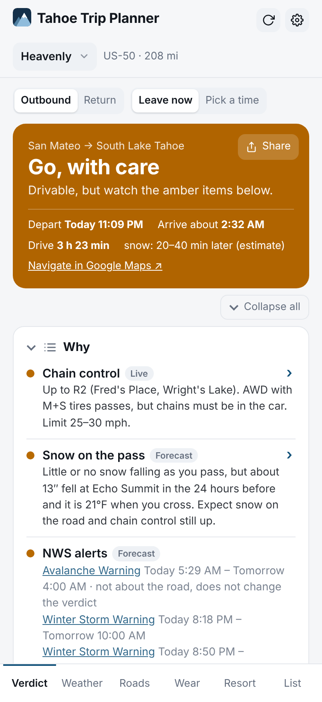
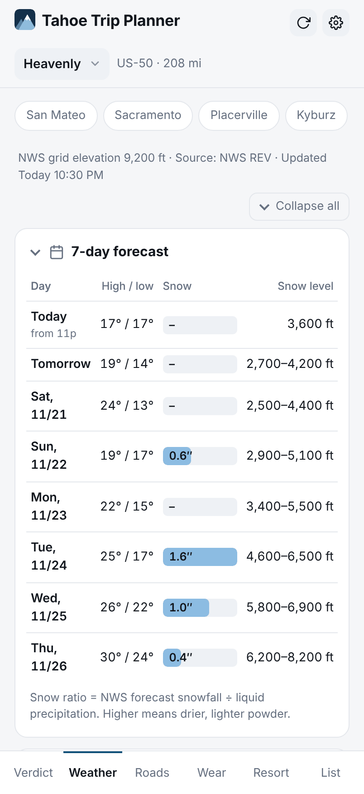
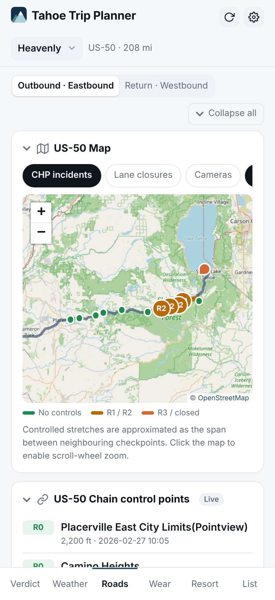
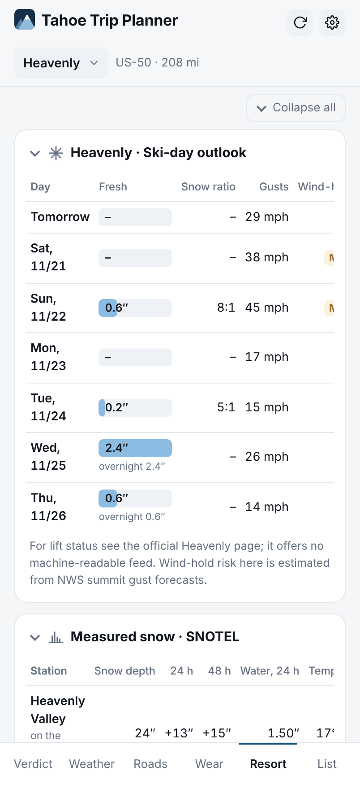
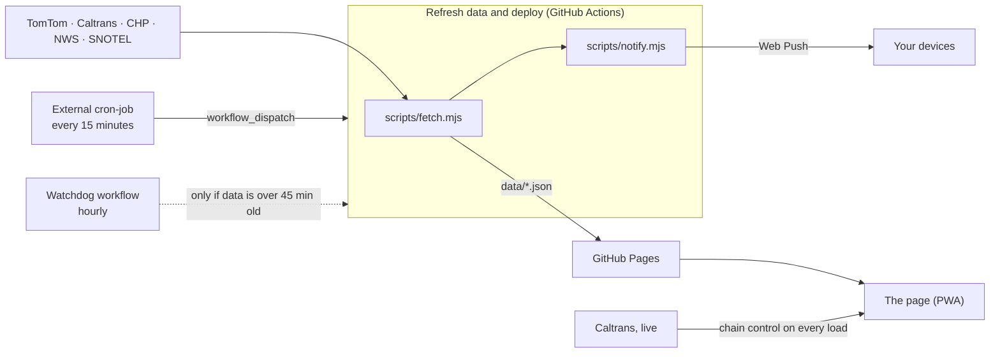

<div align="center">


# Tahoe Trip Planner

**Should I drive up to Tahoe today, and when should I leave?**

A go / no-go dashboard for driving from the Bay Area to a Tahoe ski resort.

[](https://github.com/ColeridgeGuo/tahoe-trip-planner/actions/workflows/test.yml)
[](https://github.com/ColeridgeGuo/tahoe-trip-planner/actions/workflows/deploy.yml)
[](https://github.com/ColeridgeGuo/tahoe-trip-planner/actions/workflows/watchdog.yml)

**English** · [简体中文](README.zh-CN.md)

[Open the app](https://coleridgeguo.github.io/tahoe-trip-planner/)



</div>

## What it does

It reads chain control, closures, CHP incidents, the forecast along the road and live drive times, and turns them into one answer for your car: **Good to go**, **Go, with care** or **Don't go**, with the reasons underneath.

| Resort | Road | Drive times |
| --- | --- | --- |
| Heavenly | US-50 over Echo Summit | TomTom, live and forecast |
| Kirkwood | CA-88 over Carson Spur | Usual time, with a Google Maps link for the live one |
| Northstar | I-80 over Donner Summit, then CA-267 | Usual time, with a Google Maps link for the live one |

The trip starts in San Mateo. The page is in English and Chinese, in °F or °C, miles or kilometres, light or dark.

## Screenshots

| Verdict | Weather | Roads | Resort |
| :---: | :---: | :---: | :---: |
|  |  |  |  |

## Features

**Verdict**

- One answer for the outbound or the return drive, leaving now or at an hour you pick in the next 7 days.
- Judged for the vehicle set in Settings: a car that needs chains and has none gets a no-go where an AWD with snow tires gets a caution.
- Counts snow that is forecast to fall as you cross, and snow that fell in the 24 hours before and is still frozen on the road.
- Best time to leave, hour by hour and across the week. For the drive home it names the latest departure the forecast still calls clear.
- Tells you when the drive reaches the mountain after dark.
- A share link that opens the same resort, direction and departure for someone else.

**Roads**

- A map (Leaflet) with chain control, CHP incidents, lane closures, cameras, live traffic and places to eat.
- Every chain-control checkpoint with its live level, read straight from Caltrans each time the page opens.
- A 48-hour timeline of the chain control that was really in force.
- Caltrans cameras, with the live stream played in the page (hls.js) where one exists.
- Alternate routes, each judged on every road it uses.

**Weather, Wear and Resort**

- A 7-day forecast for each point on the route, shown for the moment you drive past it.
- What to wear on the mountain and in town, from the feels-like low, gusts and snowfall.
- A ski-day outlook (fresh snow, snow ratio, gusts, wind-hold risk), measured snow depth from SNOTEL and the resort webcams.

**Alerts and checklist**

- Change alerts: pick a departure and turn the alert on. A push notification arrives when the verdict or the chain-control level changes, or the drive time moves 30 minutes or more, plus a summary at 8 pm the evening before and two hours before leaving.
- A packing checklist kept in the browser, with optional sync across devices through a private GitHub Gist.

**App**

- Installs to the Home Screen as a PWA and opens offline with the last data it saw.
- No account, no backend, no tracking.

## Tech stack

| Part | What it uses |
| --- | --- |
| Page | Plain HTML, CSS and native JavaScript modules. No framework, no bundler, no build step |
| Map | [Leaflet](https://leafletjs.com/), vendored in `js/vendor`, with OpenStreetMap tiles |
| Live cameras | [hls.js](https://github.com/video-dev/hls.js) (iPhones play the streams natively) |
| Offline and install | Web app manifest and a Service Worker (`sw.js`) |
| Notifications | Web Push, sent from the workflow by `scripts/notify.mjs` |
| Data | Node 22 scripts with no dependencies, run in GitHub Actions |
| Hosting | GitHub Pages |
| Tests | `node --test`, 320 tests |

## Data sources

| Source | What it gives | Key |
| --- | --- | --- |
| [TomTom](https://developer.tomtom.com/) Routing and Traffic | Drive times now and for later departures, traffic flow on the map | Yes, free tier |
| [Caltrans](https://cwwp2.dot.ca.gov/) | Chain control, lane closures, cameras and live streams | No |
| [CHP](https://cad.chp.ca.gov/) | Traffic incidents | No |
| [NWS](https://www.weather.gov/documentation/services-web-api) | Gridded forecasts and weather alerts | No |
| [NRCS SNOTEL](https://wcc.sc.egov.usda.gov/) | Measured snow depth and water | No |

The estimates are guidance only. Trust the official information before you drive.

## How it is put together



- `scripts/fetch.mjs` pulls every source and writes `data/<destination>.json`. Nothing is committed back to the repository.
- `.github/workflows/deploy.yml` runs that script, sends change alerts, and publishes the site to GitHub Pages.
- The workflow has no schedule of its own. An external cron-job triggers it every 15 minutes through `workflow_dispatch`, because GitHub's built-in scheduler runs late and unevenly. The script decides on each run which TomTom requests are due.
- `.github/workflows/watchdog.yml` is the safety net, see [Watchdog](#watchdog).
- `.github/workflows/test.yml` runs the tests on every pull request and every push to `main`. It is kept apart from the deploy so that a refresh never waits on it.

<details>
<summary><b>Drive times and the TomTom allowance</b></summary>

- Only Heavenly (`driveTimes: 'tomtom'` in `js/config.js`) gets drive times from TomTom; it uses the whole free allowance. Kirkwood and Northstar (`driveTimes: 'maps'`) send no TomTom requests: the page uses the route's usual drive time for them and links to Google Maps for the live one (`mapsUrl` in `js/logic.js`, a plain Maps URL, no key and no charge; it cannot carry a departure time, so a later departure is set inside Google Maps). The best-departure hints, drive-time bars and drive-time alerts therefore exist for Heavenly only.
- Drive times come from TomTom (`TOMTOM_KEY` secret): live every 30 minutes, hourly for the next 24 h (the next 3 hours refreshed hourly, the rest every 12 h), and every 2 h out to 8 days (refreshed once a day). That is about 506 requests a day, or 15,700 of the 20,000 free Routing API requests a month.
- Each drive time also says when the drive reaches every point along the route (Sacramento, Placerville, Kyburz, Echo Summit), read off the route TomTom returned, so the weather shown for a point is the weather at the moment you are there. This costs no extra requests. A point the chosen route does not pass (TomTom sometimes goes via Stockton instead of Sacramento) is placed between its neighbours.
- TomTom's drive time for a later departure is its usual traffic for that hour and knows nothing about snow. When the forecast has snow falling or lying as you cross, the page adds an estimated range for the pass (`TH.snowDelay`: 20-40 min in light snow or on packed snow, 45-90 min in heavy snow) next to the drive time and the arrival time. The TomTom figure itself, the pass-through times and the verdict are not changed by it. Leaving now with chain control already up, the live time is left as it is.
- `data/<destination>.json` carries `tomtom`: the requests sent so far today (UTC day), yesterday's total, and the month's count against the 20,000 allowance (`monthN`, `quota`, and `from`, the day the month's count began), also printed in the run log. The page shows the month's count in the footer. From 80% of the allowance, and again past it, the page shows a banner and the devices registered for change alerts get one notification each time (`quotaNote` in `scripts/notify.mjs`). Only requests sent by the fetch script are counted, so the TomTom dashboard remains the reference.

</details>

<details>
<summary><b>How the verdict is reached</b></summary>

- The verdict also counts snow that has already fallen: enough new snow in the 12 or 24 hours before you cross, while it is still freezing, is a caution even when nothing is falling any more (`TH.pack` in `js/logic.js`). The fetch script keeps the last 24 hours of snowfall (`snowPast`) for this.
- Forecast snow is judged for the vehicle set in Settings: heavy snow, or snow lying on the road, is treated as R2 chain control, so a car that needs chains and has none gets a no-go instead of a caution; light snow only adds a reminder to bring chains.
- Only CHP collisions on the mountain section (east of `route.mountainLonMin`, Placerville) change the verdict. Valley incidents are listed, and their delay is already in the TomTom drive time.
- Chain control that cannot be read is never shown as "no chain control": a checkpoint whose status is not an R level or a closure (traffic being held, for instance), or a feed that answers without any checkpoint for the route, gives "cannot confirm" and a caution.
- Only NWS alerts about the road change the verdict (winter storm, blizzard, ice, snow squall, high wind, fog, flooding; `alertLevel` in `js/logic.js`). Others, such as Lake Wind Advisory or Freeze Warning, are listed without changing it. That includes Avalanche Warning and Watch: they are for the backcountry, and a slide path that threatens the highway shows up as a Caltrans closure.
- A lane closure counts when it is in force as the drive reaches that stretch (within 30 minutes either way), not at any time during the drive.
- Alternate routes are judged on every road they use (`alternates[].legs` in `js/config.js`): I-80 with CA-89 past Emerald Bay, CA-88 with CA-89 over Luther Pass.
- For the drive home, the hour strip and the week chart name the latest departure of the day that the forecast still calls clear, when leaving later is worse (`lastClear` in `js/logic.js`). A change alert on a return trip states it, and sends a notification when it appears, goes, or moves two hours or more.
- The page additionally reads chain control straight from Caltrans on every load, so that part is always live. If those direct requests stop working while the page stays open, the reading from the scheduled refresh takes over as soon as it is the newer one.

</details>

<details>
<summary><b>Measured snow and history</b></summary>

- The resort tab shows measured snow next to the forecast: depth, its change over 24 and 48 hours, and the water that fell in 24 hours, from the NRCS SNOTEL stations listed under `resort.snotel` in `js/config.js` (one free request per destination an hour, no key). The depth is also kept in `data/history.json` (`sd`).
- `data/history.json` records, hour by hour, the real chain-control level each way next to the snowfall and temperature forecast for that hour (about two months). It is there to check the snow thresholds against real storms. Each row also keeps the live drive time each way and the minutes spent on the mountain section (`d`, `m`), to replace the estimated snow delay with measured figures.

</details>

<details>
<summary><b>When a source fails</b></summary>

- If a source fails on a run, its last good data is carried over from the previously published file (up to 24 h) and the page shows how old it is.
- Every run starts by reading back what the previous run published (the data file and `history.json`), with several tries. If the site cannot be reached at all the run stops without deploying, rather than publish a file that has forgotten the last day's snowfall and refetch every TomTom forecast; the next run tries again.
- Change alerts on a run where a source failed: the verdict is held at what was last sent (a gap in the data is not a change in the road), but a chain-control change read from a working feed, a drive-time change and the two summaries still go out, and the summary says which source did not update.

</details>

<details>
<summary><b>Change alerts, share links and the checklist</b></summary>

- Change alerts: pick a departure time on the Verdict tab and turn on the alert. The page saves that departure and the device's Web Push subscription in the same private Gist as the checklist; after every refresh `scripts/notify.mjs` re-evaluates it and pushes a notification when the verdict or the chain-control level changed, or the drive time moved 30 minutes or more from the one last reported, plus a summary at 8 pm the evening before and two hours before leaving. What was last sent is published as `data/alerts.json` (a hash, two levels and a drive time, no trip details).
- Share links: the Share button in the corner of the verdict card makes a link carrying the destination, the direction and the picked departure (`?resort=kirkwood&dir=back&date=2026-11-22&time=7:00`, see `js/share.js`). Opening it shows that view once, without changing the reader's saved destination, and the parameters are then removed from the address. A departure that has gone by opens as "leave now". Phones use the system share sheet, computers copy the link. It is all in the page: no request is added anywhere.
- The checklist is stored in the browser and can sync through a private GitHub Gist (Settings → paste a token with only the `gist` scope).

</details>

## Watchdog

`.github/workflows/watchdog.yml` is a safety net for the external cron-job. Once an hour (GitHub's own scheduler) it checks how old the published data is. Up to 45 minutes it does nothing. Beyond that it starts the refresh itself, and that run pushes a "scheduled refresh stopped" notification to the devices registered for change alerts, once a day at most. It fetches nothing while the cron-job works. GitHub disables scheduled workflows after 60 days without a commit and emails the owner when it does.

## Deploy your own

1. Fork the repository. Repo → Settings → Pages → Source: **GitHub Actions**.
2. Repo → Settings → Secrets and variables → Actions: add `TOMTOM_KEY` (optional; without it the page uses a fixed drive time).
3. For change alerts, add the secret `ALERT_GIST_ID` (the ID is shown under Settings → Change alerts once sync is connected). On an iPhone the page has to be added to the Home Screen to receive notifications.
4. Push to `main`. The first run deploys the site.
5. Point an external cron-job at the workflow's `workflow_dispatch` endpoint (`POST /repos/<owner>/<repo>/actions/workflows/deploy.yml/dispatches` with `{"ref":"main"}` and a token that has Actions write access), every 15 minutes.

Keys and tokens live only in repository secrets and in your own browser. None are in the code.

## Run locally

Node 22 or later. There is nothing to install.

```bash
node scripts/fetch.mjs          # writes data/*.json; set TOMTOM_KEY for real drive times
python3 -m http.server 8000     # then open http://localhost:8000
```

## Tests

```bash
node --test "test/*.test.mjs"
```

No dependencies (Node 22+). They cover the verdict, chain control per vehicle, closure and incident direction, what happens when a source fails, pass-through times and change alerts, and run on every pull request (`.github/workflows/test.yml`).

## Project layout

```
index.html, css/        the page shell and styles
js/app.js               rendering and interaction
js/logic.js             the verdict and its thresholds (TH)
js/config.js            destinations, route points, cameras
js/normalize.js         turns the raw feeds into one shape
js/alerts.js, sync.js   change alerts and Gist sync
js/share.js, food.js    share links, places to eat
js/i18n.js              English and Chinese text
js/routes/              the map line of each route
js/vendor/              Leaflet and hls.js
sw.js                   Service Worker
scripts/fetch.mjs       fetches every source (runs in Actions)
scripts/notify.mjs      sends change alerts
scripts/lib.mjs         pure helpers and the TomTom budget
test/                   node --test suites
```

## Add a destination

Append an entry to `DESTINATIONS` in `js/config.js` (route points, highways, resort cams), add its map line as `js/routes/<id>.js`, and list that file in `SHELL` in `sw.js`. Thresholds for the verdict live in `TH` in `js/logic.js`.

- `drivePins` are the waypoints TomTom is routed through. Use only points on the mountain road, never a town centre. On a divided freeway give the point a `pin` with a spot on each carriageway (see Donner Summit).
- A trip that uses a second highway at the end lists it under `route.also` with its own directions (CA-267 for Northstar); chain control, closures and incidents are then checked on both. `route.lonMax` cuts off what lies past the turn-off.
- Every new destination adds TomTom requests: redo the budget in `scripts/lib.mjs` (a test checks it stays under the quota).
