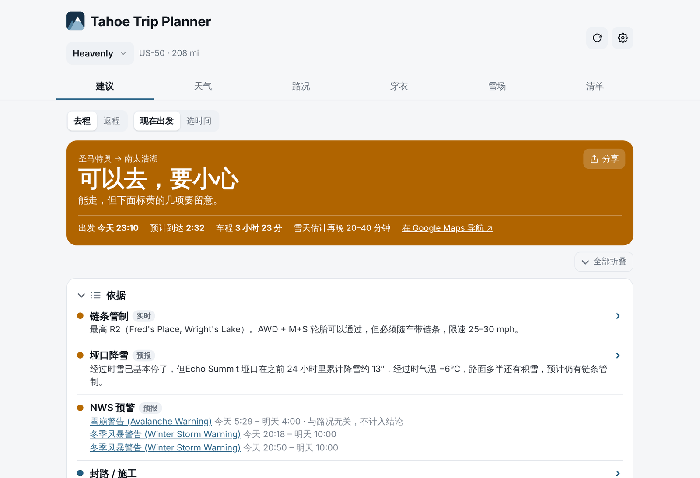
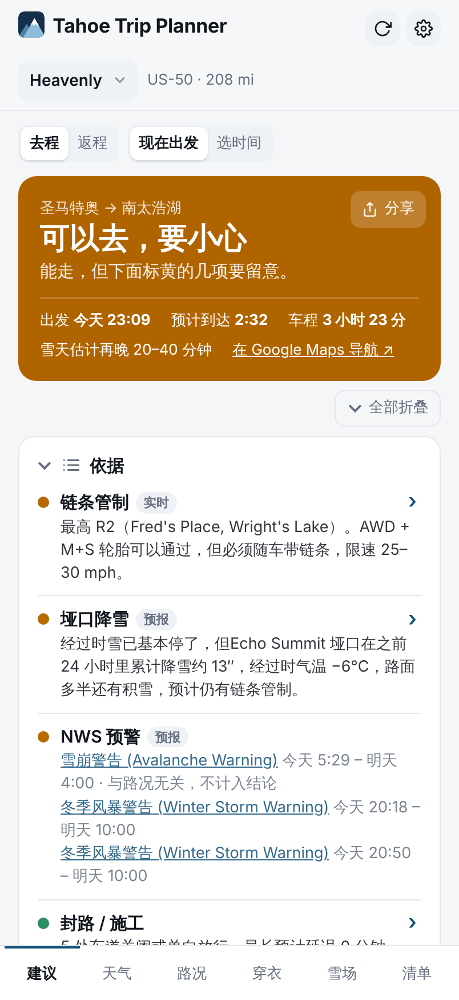
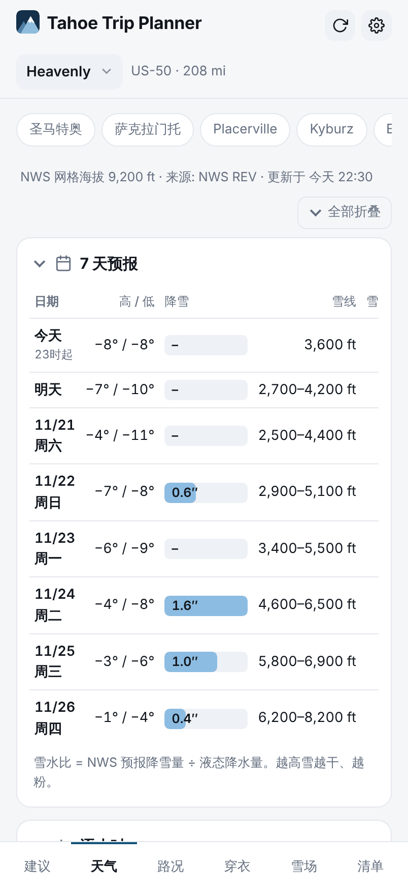
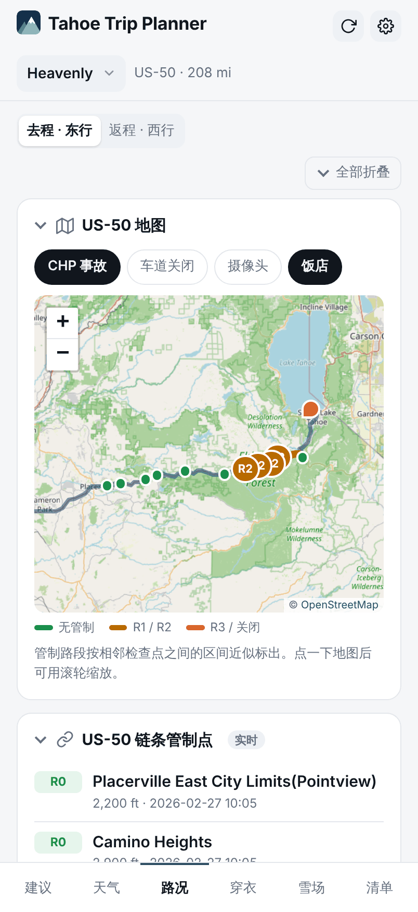
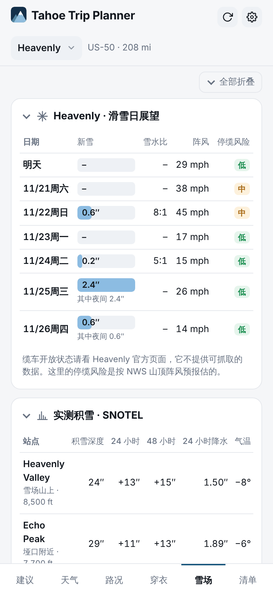
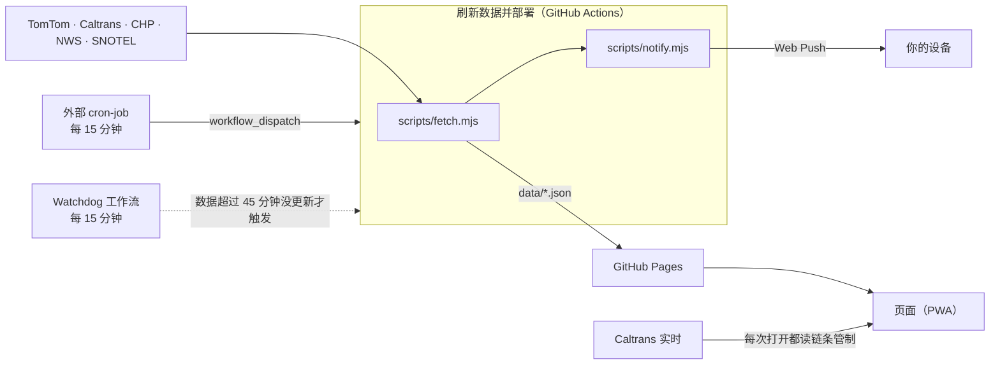

<div align="center">


# Tahoe 滑雪出行助手

**今天能不能开车上 Tahoe？几点出发最合适？**

从湾区开车去 Tahoe 滑雪场的“去不去”看板。

[](https://github.com/ColeridgeGuo/tahoe-trip-planner/actions/workflows/test.yml)
[](https://github.com/ColeridgeGuo/tahoe-trip-planner/actions/workflows/deploy.yml)
[](https://github.com/ColeridgeGuo/tahoe-trip-planner/actions/workflows/watchdog.yml)

[English](README.md) · **简体中文**

[打开页面](https://coleridgeguo.github.io/tahoe-trip-planner/)



</div>

## 它做什么

它读取链条管制、封路、CHP 事故、沿途天气预报和实时车程，按你的车给出一个结论：**可以出发**、**可以去，要小心**，或者**别去**，原因列在下面。

| 雪场 | 公路 | 车程 |
| --- | --- | --- |
| Heavenly | US-50，翻 Echo Summit | TomTom 实时和预测 |
| Kirkwood | CA-88，翻 Carson Spur | 平常车程，实时的点链接到 Google Maps 看 |
| Northstar | I-80 翻 Donner Summit，再走 CA-267 | 平常车程，实时的点链接到 Google Maps 看 |

出发地是圣马特奥。页面有中文和英文，温度可选 °C 或 °F，长度可选英里或公里，有浅色和深色外观。

## 截图

| 建议 | 天气 | 路况 | 雪场 |
| :---: | :---: | :---: | :---: |
|  |  |  |  |

## 功能

**建议**

- 去程或返程各给一个结论，可以看现在出发，也可以选未来 7 天里的某个小时。
- 按设置里的车辆判断：需要链条却没带的车得到“别去”，四驱加雪胎的车在同样的路况下只是“要小心”。
- 既算经过时预报在下的雪，也算之前几天下的、还冻在路面上的雪。
- 按小时和按一周给出建议出发时间。返程还会标出当天预报仍然无碍的最晚出发时间。
- 提示会不会在天黑后才开到山路段。
- 分享链接：对方打开就是同一个雪场、方向和出发时间。

**路况**

- 地图（Leaflet）上有链条管制、CHP 事故、车道封闭、摄像头、实时路况和沿路吃饭的地方。
- 每个链条管制检查点的实时等级，每次打开页面都直接从 Caltrans 读取。
- 过去 48 小时实际链条管制的时间线。
- Caltrans 摄像头，有直播的可以直接在页面里播放（hls.js）。
- 备选路线，按它用到的每一条公路分别判断。

**天气、穿衣和雪场**

- 沿途每个点的 7 天预报，显示的是你开到那里时的天气。
- 山上和镇上各穿什么，根据体感最低温、阵风和降雪给出。
- 滑雪日展望（新雪、雪水比、阵风、大风停运风险），SNOTEL 实测积雪深度，还有雪场摄像头。

**提醒和清单**

- 变化提醒：选好出发时间后打开提醒。结论或链条管制等级一变，或者车程变动 30 分钟以上，就推送通知；出发前一晚 8 点和出发前 2 小时各发一条汇总。
- 携带清单存在浏览器里，可以通过私密 GitHub Gist 在多台设备间同步。

**应用**

- 可以作为 PWA 添加到主屏幕，离线时用上次的数据也能打开。
- 不用注册，没有后端，没有跟踪。

## 技术栈

| 部分 | 用的是什么 |
| --- | --- |
| 页面 | 纯 HTML、CSS 和原生 JavaScript 模块，不用框架，不打包，没有构建步骤 |
| 地图 | [Leaflet](https://leafletjs.com/)（放在 `js/vendor`），底图是 OpenStreetMap |
| 摄像头直播 | [hls.js](https://github.com/video-dev/hls.js)（iPhone 用系统自带播放） |
| 离线和安装 | Web app manifest 加 Service Worker（`sw.js`） |
| 通知 | Web Push，由工作流里的 `scripts/notify.mjs` 发送 |
| 数据 | 无依赖的 Node 22 脚本，在 GitHub Actions 里运行 |
| 托管 | GitHub Pages |
| 测试 | `node --test`，320 个测试 |

## 数据来源

| 来源 | 提供什么 | 是否要密钥 |
| --- | --- | --- |
| [TomTom](https://developer.tomtom.com/) 路线和交通 | 现在和之后出发的车程，地图上的路况 | 要，免费额度 |
| [Caltrans](https://cwwp2.dot.ca.gov/) | 链条管制、车道封闭、摄像头和直播 | 不要 |
| [CHP](https://cad.chp.ca.gov/) | 交通事故 | 不要 |
| [NWS](https://www.weather.gov/documentation/services-web-api) | 网格预报和天气预警 | 不要 |
| [NRCS SNOTEL](https://wcc.sc.egov.usda.gov/) | 实测积雪深度和雪水量 | 不要 |

估算仅供参考，上路前以官方信息为准。

## 整体结构



- `scripts/fetch.mjs` 抓取所有来源，写出 `data/<目的地>.json`。不往仓库里提交任何数据。
- `.github/workflows/deploy.yml` 运行这个脚本、发送变化提醒，再把站点发布到 GitHub Pages。
- 这个工作流自己没有定时。由外部 cron-job 每 15 分钟通过 `workflow_dispatch` 触发，因为 GitHub 自带的定时又晚又不均匀。每次运行时脚本自己决定哪些 TomTom 请求到期该发了。
- `.github/workflows/watchdog.yml` 是兜底，见 [Watchdog](#watchdog)。
- `.github/workflows/test.yml` 在每个 pull request 和每次推送到 `main` 时跑测试。它和部署分开，刷新数据不用等它。

<details>
<summary><b>车程和 TomTom 额度</b></summary>

- 只有 Heavenly（`js/config.js` 里 `driveTimes: 'tomtom'`）从 TomTom 取车程，免费额度全部给它用。Kirkwood 和 Northstar（`driveTimes: 'maps'`）不发 TomTom 请求：页面用这条路线的平常车程，实时车程链接到 Google Maps 去看（`js/logic.js` 的 `mapsUrl`，普通的地图网址，不要密钥也不收费；它带不了出发时间，之后出发要在 Google Maps 里自己设）。所以建议出发时间、车程条和车程提醒只有 Heavenly 有。
- 车程来自 TomTom（密钥放在 `TOMTOM_KEY` secret 里）：实时车程每 30 分钟一次，未来 24 小时按小时（最近 3 小时每小时刷新，其余每 12 小时刷新），之后到第 8 天每 2 小时一个点（每天刷新一次）。合计每天约 506 次请求，每月约 15,700 次，免费的 Routing API 额度是每月 20,000 次。
- 每个车程还带有开到沿途各点（Sacramento、Placerville、Kyburz、Echo Summit）的时刻，是从 TomTom 返回的路线上读出来的，所以某个点显示的天气就是你开到那里时的天气。这不多花请求。所选路线不经过的点（TomTom 有时走 Stockton 而不走 Sacramento）按前后两点之间估算。
- TomTom 对之后出发给的车程是那个小时的平常路况，不知道下雪。预报显示经过时在下雪或路面有积雪时，页面会在车程和到达时间旁边加一个山口路段的估计范围（`TH.snowDelay`：多 10 到 30 分钟，按 2026 年 11 月 18 到 20 日那场雪的实测；不含临时拦车，页面上另有文字说明）。TomTom 的数字、沿途各点的时刻和结论都不因此改变。现在出发且链条管制已经在执行时，实时车程保持原样。
- `data/<目的地>.json` 里有 `tomtom`：今天（按 UTC 日）已发的请求数、昨天的总数，以及本月相对 20,000 额度的计数（`monthN`、`quota`，`from` 是本月开始计数的那天），运行日志里也会打印。页面页脚显示本月用量。用到额度的 80% 时、以及超过额度时，页面各显示一次横幅，登记了变化提醒的设备各收到一条通知（`scripts/notify.mjs` 的 `quotaNote`）。这里只统计抓取脚本发出的请求，准确数字以 TomTom 后台为准。

</details>

<details>
<summary><b>结论是怎么得出的</b></summary>

- 结论也算已经下过的雪：经过前 12、24 或 72 小时内新雪够多、而且气温还在冰点以下，即使已经不下了也算“要小心”（`js/logic.js` 的 `TH.pack`）。抓取脚本为此保留最近 72 小时的降雪（`snowPast`）。
- 预报降雪按设置里的车辆判断：大雪或路面积雪按 R2 链条管制处理，需要链条却没带的车得到“别去”而不是“要小心”；小雪只提醒带上链条。
- 只有山路段（`route.mountainLonMin` 即 Placerville 以东）的 CHP 碰撞事故会改变结论。平原段的事故只列出来，它们造成的延误已经算在 TomTom 车程里。
- 读不出来的链条管制绝不显示成“没有链条管制”：检查点的状态既不是 R 等级也不是封路（比如车辆被拦停），或者接口有回应却没有这条路线的任何检查点，都显示“无法确认”并给出“要小心”。
- 只有和道路有关的 NWS 预警会改变结论（冬季风暴、暴风雪、冰、雪飑、大风、雾、洪水；`js/logic.js` 的 `alertLevel`）。其他的，比如 Lake Wind Advisory 或 Freeze Warning，只列出不影响结论。雪崩警告和雪崩观察也一样：它们针对的是野雪区，真威胁到公路的雪崩路段会表现为 Caltrans 封路。
- 车道封闭只在你开到那一段时正在生效（前后 30 分钟内）才算，不是行程中任何时刻生效都算。
- 备选路线按它用到的每条公路判断（`js/config.js` 的 `alternates[].legs`）：I-80 加经过 Emerald Bay 的 CA-89，CA-88 加翻 Luther Pass 的 CA-89。
- 返程时，如果晚走更糟，按小时的出发条和一周图会标出当天预报仍然无碍的最晚出发时间（`js/logic.js` 的 `lastClear`）。返程的变化提醒里会写明它，在它出现、消失或变动 2 小时以上时发通知。
- 页面每次打开还会直接从 Caltrans 读链条管制，所以这部分始终是实时的。如果页面开着的时候这些直连请求不通了，定时刷新读到的数据一旦更新，就改用它。

</details>

<details>
<summary><b>实测积雪和历史记录</b></summary>

- “雪场”页在预报旁边显示实测积雪：雪深、24 和 48 小时的变化、24 小时的雪水量，来自 `js/config.js` 里 `resort.snotel` 列出的 NRCS SNOTEL 站（每个目的地每小时一次免费请求，不要密钥）。雪深也记在 `data/history.json` 里（`sd`）。
- `data/history.json` 按小时记录每个方向实际的链条管制等级，旁边是那个小时预报的降雪和气温（保留约两个月）。用来拿真实的风暴校准降雪阈值。每行还记下各方向的实时车程和山路段花的分钟数（`d`、`m`），以后用实测数字替换估计的雪天延误。

</details>

<details>
<summary><b>某个数据来源失败时</b></summary>

- 某次运行里一个来源失败，就沿用上次发布文件里它最后一份好数据（最多 24 小时），页面上显示这份数据有多旧。
- 每次运行先读回上一次发布的内容（数据文件和 `history.json`），会重试几次。如果站点完全连不上，这次运行就停下不部署，而不是发布一份忘了前一天降雪、又把 TomTom 预测全部重抓一遍的文件；下次运行再试。
- 某个来源失败的那次运行里，变化提醒这样处理：结论保持上次发出的（数据缺了一块不等于路况变了），但从正常接口读到的链条管制变化、车程变化和两条汇总照常发出，汇总里会说明哪个来源没更新。

</details>

<details>
<summary><b>变化提醒、分享链接和清单</b></summary>

- 变化提醒：在“建议”页选好出发时间后打开提醒。页面把这个出发时间和设备的 Web Push 订阅存进和清单同一个私密 Gist；每次刷新后 `scripts/notify.mjs` 重新判断，结论或链条管制等级变了、或者车程比上次通知时变动 30 分钟以上就推送，另外在出发前一晚 8 点和出发前 2 小时各发一条汇总。上次发了什么发布在 `data/alerts.json` 里（一个哈希、两个等级和一个车程，不含行程细节）。
- 分享链接：结论卡片角上的“分享”按钮生成一个带目的地、方向和所选出发时间的链接（`?resort=kirkwood&dir=back&date=2026-11-22&time=7:00`，见 `js/share.js`）。打开后只显示这一次，不改对方保存的目的地，随后参数从地址里去掉。出发时间已经过了就按“现在出发”打开。手机用系统分享，电脑复制链接。全部在页面里完成，不增加任何请求。
- 清单存在浏览器里，可以通过私密 GitHub Gist 同步（设置里粘贴一个只有 `gist` 权限的令牌）。

</details>

## Watchdog

`.github/workflows/watchdog.yml` 是外部 cron-job 的兜底。它检查已发布的数据有多旧。45 分钟以内什么都不做。超过了就自己启动刷新（已经有一次刷新在跑就不重复启动），那次运行会给登记了变化提醒的设备推送一条“定时刷新停了”的通知，每天最多一次。cron-job 正常时它不抓取任何数据。

它有两个触发来源，哪一个都不必准时：

- 外部 cron-job 里的第二个任务，在每小时的 7、22、37、52 分调用 `watchdog.yml` 的 `workflow_dispatch`。靠它，刷新停了一小时内就能发现。
- GitHub 自带的定时，同样的分钟。GitHub 的定时很不准（原来设的每小时一次，实际大约 8 小时才跑一次），所以它只在外部服务本身或两个任务共用的令牌出问题时兜底。仓库 60 天没有提交时 GitHub 会停用定时工作流，停用时会发邮件给仓库所有者。

## 部署自己的一份

1. Fork 这个仓库。仓库 → Settings → Pages → Source 选 **GitHub Actions**。
2. 仓库 → Settings → Secrets and variables → Actions：添加 `TOMTOM_KEY`（可选；没有的话页面用固定车程）。
3. 要用变化提醒，再添加 secret `ALERT_GIST_ID`（同步连上后，这个 ID 显示在页面的设置 → 变化提醒里）。iPhone 上要先把页面添加到主屏幕才能收到通知。
4. 推送到 `main`。第一次运行就会部署站点。
5. 让外部 cron-job 每 15 分钟调用一次工作流的 `workflow_dispatch` 接口（`POST /repos/<owner>/<repo>/actions/workflows/deploy.yml/dispatches`，内容 `{"ref":"main"}`，令牌要有 Actions 写权限）。
6. 在同一个 cron-job 服务里再加一个任务，在每小时的 7、22、37、52 分调用 `POST /repos/<owner>/<repo>/actions/workflows/watchdog.yml/dispatches`，内容和令牌同上。建议把两个任务的失败通知都打开。

密钥和令牌只存在仓库的 secrets 和你自己的浏览器里，代码里没有。

## 本地运行

需要 Node 22 或更新版本，不用安装任何依赖。

```bash
node scripts/fetch.mjs          # 写出 data/*.json；设了 TOMTOM_KEY 才有真实车程
python3 -m http.server 8000     # 然后打开 http://localhost:8000
```

## 测试

```bash
node --test "test/*.test.mjs"
```

没有依赖（Node 22+）。覆盖结论、不同车辆的链条管制、封路和事故的方向、数据来源失败时的处理、沿途各点的时刻和变化提醒，每个 pull request 都会跑（`.github/workflows/test.yml`）。

## 目录结构

```
index.html, css/        页面骨架和样式
js/app.js               渲染和交互
js/logic.js             结论和阈值（TH）
js/config.js            目的地、沿途各点、摄像头
js/normalize.js         把各来源的原始数据整理成统一格式
js/alerts.js, sync.js   变化提醒和 Gist 同步
js/share.js, food.js    分享链接、沿路吃饭
js/i18n.js              中文和英文文字
js/routes/              每条路线在地图上的线
js/vendor/              Leaflet 和 hls.js
sw.js                   Service Worker
scripts/fetch.mjs       抓取所有来源（在 Actions 里运行）
scripts/notify.mjs      发送变化提醒
scripts/lib.mjs         纯函数和 TomTom 预算
test/                   node --test 测试
```

## 添加目的地

在 `js/config.js` 的 `DESTINATIONS` 里加一项（沿途各点、公路、雪场摄像头），把它的地图线加为 `js/routes/<id>.js`，并把这个文件列进 `sw.js` 的 `SHELL`。结论的阈值在 `js/logic.js` 的 `TH` 里。

- `drivePins` 是 TomTom 选路时经过的途经点。只用山路上的点，不要用市中心。在分隔式高速上，给这个点加 `pin`，去程和返程各放一个落在对应车道上的坐标（参考 Donner Summit）。
- 行程最后一段用到第二条公路时，把它写在 `route.also` 里并给出自己的方向（Northstar 的 CA-267）；链条管制、封路和事故会在两条路上都检查。`route.lonMax` 用来排除转出点之后的记录。
- 每加一个目的地都会增加 TomTom 请求：要重算 `scripts/lib.mjs` 里的预算（有一条测试检查它不超过额度）。
